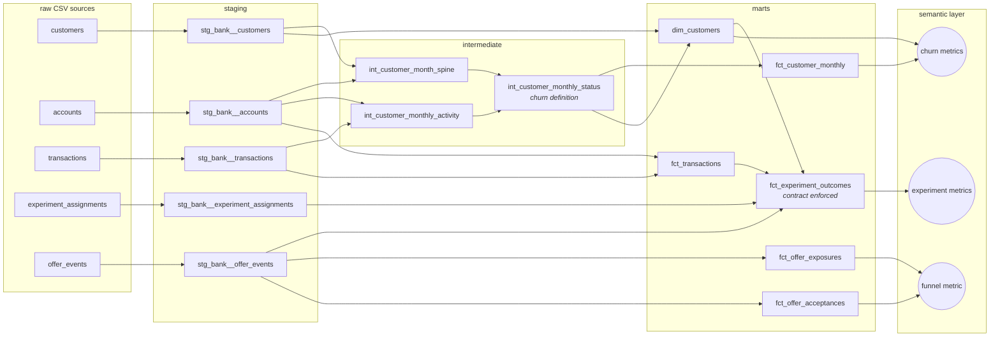

# Retention & Experiment Metrics on the dbt Semantic Layer

[](https://github.com/crystal1361/dbt-retention-experiment-metrics/actions/workflows/ci.yml)

A production-style dbt project that turns raw core-banking data into **governed
churn and experiment metrics** — one definition of "churn", one definition of
"retention lift", queryable from any tool through the dbt Semantic Layer
(MetricFlow).

It runs end to end on a laptop (dbt Core + DuckDB, no cloud account) and in
GitHub Actions on every push.

**Scenario.** Northwind Bank (fictional) wants to know (1) how many checking
customers it loses each month, and (2) whether a fee-waiver retention offer,
tested in a randomized experiment on at-risk customers in Q2 2025, actually
kept people banking. The raw data is synthetic and generated by
[`scripts/generate_data.py`](scripts/generate_data.py) with a *known* treatment
effect planted in it, so every metric can be checked against ground truth.

---

## What this project demonstrates

| | |
|---|---|
| **Layered modeling** | sources → staging → intermediate → marts, each layer with one job |
| **Metric definitions as code** | 6 semantic models, 14 metrics covering every MetricFlow type: simple, ratio, cumulative, derived, conversion |
| **Experiment rigor in the pipeline** | SRM check, control-contamination check, CUPED covariate, CACE and MDE in the readout |
| **Testing pyramid** | 48 data tests, 2 unit tests pinning the churn boundary, model contract on the experiment fact, custom generic tests |
| **Reproducibility** | Seeded data generator, pinned dependencies, CI builds and queries metrics from scratch |

## Lineage



## Metric catalog

| Metric | Type | Definition |
|---|---|---|
| `active_customers` | simple | Open checking account **and** a customer-initiated transaction in the trailing 90 days |
| `churned_customers` | simple | Active at the start of the month, dormant or closed by month end |
| `monthly_churn_rate` | ratio | `churned_customers / active_customers_at_start` |
| `transacting_customers_rolling_90d` | cumulative | Distinct customers transacting in a trailing 90-day window |
| `retention_rate_d90` | ratio | Share of assigned customers with any customer-initiated transaction in days (60, 90] after assignment (ITT) |
| `retention_lift_d90_pp` | derived | Treatment minus control `retention_rate_d90`, in percentage points |
| `offer_acceptance_rate_14d` | conversion | Share of offer exposures followed by an acceptance within 14 days |

Example queries:

```bash
mf query --metrics monthly_churn_rate --group-by metric_time__quarter,customer__segment
mf query --metrics retention_rate_d90,experiment_units --group-by experiment_unit__variant
mf query --metrics retention_lift_d90_pp
```

## Key design decisions

**1. Churn = 90-day dormancy, not account closure.** Most customers who leave a
bank stop using the account long before they close it, and many never close
it. A closure-only definition undercounts churn and reports it months late.
The rule lives in exactly one model (`int_customer_monthly_status`) and the
threshold is a project variable (`dormancy_days`).

**2. Fees and interest are not engagement.** The bank posts a monthly fee to
every open checking account, including dormant ones. Counting "any
transaction" as activity would make every dormant account look alive forever.
Staging flags `is_customer_initiated`, and only those transactions feed
activity.

**3. The off-by-one is pinned by a unit test.** Is a customer whose last
transaction was exactly 90 days ago active? The definition says no
(`days_since_last_txn < 90`), and `dormancy_boundary_89_vs_90_days` locks that
in. A second unit test asserts that a closed account is never active, even if
a late card refund posts afterwards.

**4. Monthly churn is a lagging indicator — by design.** A 90-day dormancy rule
detects churn roughly three months after the customer's last transaction.
In the data, the at-risk customers who stopped transacting in Apr–Jun 2025
show up as a churn spike in **Jul–Aug 2025** (2.8–2.9% vs a ~1.6% baseline).
The first 90 days of history are excluded from `fct_customer_monthly` as a
warm-up period, because without look-back every customer appears "new".

**5. Experiment outcome = activity in days 60–90, not "still active at day 90".**
Under the 90-day dormancy rule, anyone who transacted on day 1 after
assignment would count as retained at day 90, which says nothing about the
offer. Requiring activity in the third month measures whether the customer
is *still* using the account.

**6. Ratios of sums, never averages of ratios.** Every rate is a MetricFlow
`ratio` metric, so cutting by segment or rolling up across months weights
customers correctly. (At quarter grain `monthly_churn_rate` is the weighted
average *monthly* rate — documented on the metric so nobody reads it as
quarterly churn.)

**7. Randomization unit = analysis unit = customer.** One row per assigned
customer in `fct_experiment_outcomes`, with a uniqueness test on
`(experiment_id, customer_id)`.

## Testing strategy

| Layer | What is tested | Why |
|---|---|---|
| Staging | Keys unique/not null, accepted values, referential integrity | Catch bad extracts at the door |
| Intermediate | Grain uniqueness (custom `unique_combination` test), value ranges | Joins and spines are where fan-outs hide |
| Churn logic | **Unit tests**: 89 vs 90 day boundary; closed account never active | The definition everyone depends on |
| Experiment | **SRM** chi-square check (p < 0.001 fails), no control contamination, acceptance never precedes exposure | A biased experiment produces a confident wrong answer |
| Contract | `fct_experiment_outcomes` enforces column names, types, not-null, PK | Downstream analysis code depends on its shape |
| Semantic layer | `mf validate-configs` validates every metric against the warehouse in CI | Metrics break when models change |

## A bug the validation caught

The first version put exposures and acceptances in one `offer_events`
semantic model. `offer_acceptance_rate_14d` returned **33.4%** — identical to
the all-time acceptance rate, which is impossible if the 14-day window is
doing anything. Checking by hand against the fact table gave 199 / 872 =
**22.8%**.

Cause: with both event types in one semantic model, every acceptance event
was also a candidate *base* event, so it matched itself inside the window.
Splitting exposures and acceptances into separate models
(`fct_offer_exposures`, `fct_offer_acceptances`) fixed it; MetricFlow now
returns 0.228211, matching the hand calculation exactly. (MetricFlow's window
is strict: acceptance must come less than 14 days after exposure.)

Lesson: validate a new metric against an independent calculation before
anyone uses it — "the query ran" is not the same as "the number is right".

## Experiment readout: `retention_offer_2025q2`

From [`analyses/experiment_readout.sql`](analyses/experiment_readout.sql) (`make readout`):

| | Treatment | Control |
|---|---|---|
| Customers | 1,019 | 960 |
| 90-day retention | 86.65% | 83.65% |

| Estimate | Value |
|---|---|
| ITT lift | **+3.0 pp**, 95% CI [−0.1, +6.2], z = 1.88 |
| CUPED-adjusted lift | +2.9 pp, 95% CI [−0.2, +6.0] |
| Variance reduction from CUPED | 0.7% (corr(outcome, covariate) = 0.09) |
| Offer take-up in treatment | 28.6% |
| CACE (effect on customers who accepted) | **+10.5 pp** |
| MDE at 80% power, this sample | 4.5 pp |
| SRM check | Pass |

**Interpretation.** The point estimate is positive and the effect on customers
who actually accepted the offer is large, but the intent-to-treat result is
not significant at 5%: the test could only reliably detect effects of 4.5 pp
or more, and the realized effect is smaller. CUPED barely helps because
pre-period transaction *volume* is a weak predictor of a binary
*still-transacting* outcome.

**Recommendation.** Don't call this a win or a loss yet. Two levers before a
re-run: (1) a stronger CUPED covariate, such as pre-period activity trend or
days since last transaction, which plausibly track a still-transacting outcome better than volume;
(2) raising take-up (28.6%), since diluted exposure is what shrinks ITT relative
to CACE. Then size the follow-up test for a ~3 pp MDE.

## Run it

```bash
python3.12 -m venv .venv && source .venv/bin/activate
make setup     # pip install -r requirements.txt
make all       # generate data -> dbt build -> query metrics -> experiment readout
make docs      # dbt docs with lineage graph -> target/static_index.html
```

Requires Python 3.12. Everything runs locally against `northwind.duckdb`.

## Project structure

```
models/
  staging/bank/        one model per source table: rename, cast, flag system postings
  intermediate/        customer-month spine, monthly activity, churn status (+ unit tests)
  marts/core/          dim_customers, fct_customer_monthly, fct_transactions
  marts/experiments/   fct_experiment_outcomes (contract), offer exposures / acceptances
  semantic/            semantic models + metrics (MetricFlow)
  utilities/           metricflow_time_spine
  docs.md              doc blocks: churn and experiment-outcome definitions
tests/
  generic/             custom generic tests: unique_combination, accepted_range
  assert_*.sql         SRM, contamination, event ordering
analyses/              experiment readout: ITT, CI, CUPED, CACE, MDE
scripts/               synthetic data generator, analysis runner
```

---

Built by Yidan Hu — [LinkedIn](https://www.linkedin.com/in/yidan-hu)
